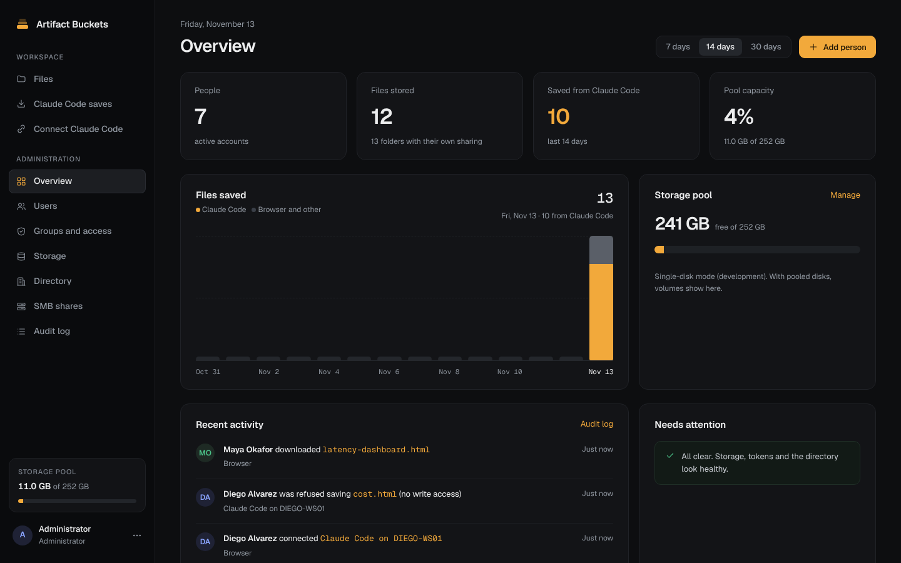
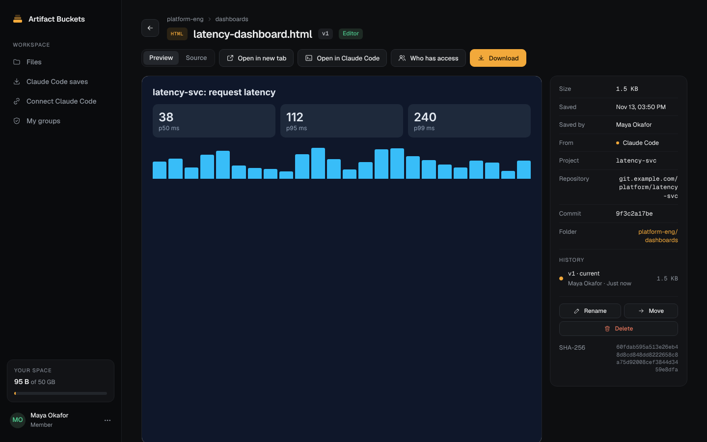
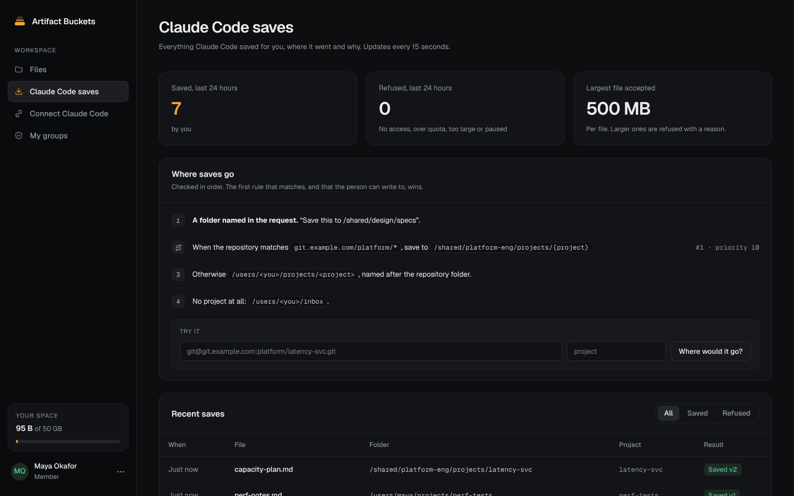

<p align="center">
  
</p>

<h1 align="center">Artifact Buckets</h1>

<p align="center">
  A self-hosted file manager for the things people make with Claude Code.<br>
  Claude Code saves straight into it. People browse, preview, version and share in the browser.
</p>

<p align="center">
  <a href="LICENSE"></a>
  
</p>

---

Claude Code makes plans, dashboards, reports, diagrams and scripts all day, and most of it ends up scattered
across laptops. Artifact Buckets gives every person and team one place for it: Claude Code saves there on its own
(through a built-in MCP server), and everyone else finds it in a fast web app.

## Features

- **Claude Code built in.** A plugin, served by your own server, adds the connection and two skills. People sign in
  once in the browser. Saves land in the person's project folder, or a team folder when a routing rule says so.
  `/buckets-open` pulls a file back into Claude Code to keep working on it.
- **Auto-sync.** Optionally copies the files Claude Code already made on a computer into the person's folders.
- **Folders and permissions.** A home folder per person and a folder per team, with Viewer / Editor / Owner roles
  that apply to everything below. Share a folder with a person or a group.
- **Previews and versions.** Markdown, HTML dashboards, CSV, images, PDF and code preview in a sandbox. Saving
  the same path makes a new version. Deletes go to a 30-day trash.
- **Admin tools.** People, groups, quotas, storage and a full audit log of every sign-in, save, open, move, delete
  and share, with CSV export.
- **Storage that stays simple.** Plain folders by default. On ZFS you get automatic restore points too.
- **Grows with you.** Local accounts to start. Active Directory groups, Entra ID sign-in and a domain-joined
  Windows (SMB) share when you need them.

<table>
  <tr>
    <td></td>
    <td></td>
  </tr>
</table>

## Quick start

On a Linux machine (Ubuntu, Debian, Fedora and friends) with a name or address people can reach:

```bash
curl -fsSL https://raw.githubusercontent.com/Trit1967/artifact-buckets/main/install.sh | sudo sh
```

It asks for the address people will use and an admin email, installs Docker if it's missing, and starts the app
with HTTPS:

- **A public name** (it resolves to a public IP, ports 80 and 443 free): a Let's Encrypt certificate.
- **A LAN name or an IP address:** a self-signed certificate for that address only. The Claude Code setup line
  offers to trust it on each computer.
- **ZFS present:** it offers to keep files on their own dataset with automatic restore points.

At the end it prints the address, the admin password and the one line that connects Claude Code.

Everything lives in `/opt/artifact-buckets` (settings, files, database, certificates) plus three containers.
Nothing else on the machine changes, apart from Docker if it had to be installed.

<details>
<summary>No questions (for scripts and cloud-init), and other options</summary>

```bash
curl -fsSL https://raw.githubusercontent.com/Trit1967/artifact-buckets/main/install.sh \
  | sudo sh -s -- --host files.example.com --email you@example.com --yes
```

**Behind a port forward or NAT:** listen on one port and tell people another, and name the outside address so the
self-signed certificate covers it:

```bash
... | sudo sh -s -- --host files.lan --https-port 443 --public-https-port 8443 \
        --http-port 80 --public-http-port 8090 --ip 203.0.113.7
```

`install.sh --help` lists the rest: your own certificate (`--tls files --cert --key`), a ZFS pool, building the
image from source, and an extra CA for builds behind a TLS-inspecting proxy.

**Without the installer:** `deploy/install/compose.yml` is plain Docker Compose. From a clone,
`cd deploy/install && cp env.example .env`, fill it in, then `docker compose up -d --build`.
</details>

### Manage it

```bash
sudo artifact-buckets status       # what's running
sudo artifact-buckets logs         # recent logs (add app, caddy or db; -f to follow)
sudo artifact-buckets password     # the first admin password
sudo artifact-buckets upgrade      # newest version; settings and data stay
sudo artifact-buckets uninstall    # remove it; files and database stay in /opt/artifact-buckets
sudo artifact-buckets uninstall --purge   # remove it and delete all its data
```

## Connect Claude Code

Open **Connect Claude Code** in the web app and paste the line it shows. It installs the plugin, then opens the
browser to sign in once:

```bash
irm https://files.example.com/claude/install.ps1 | iex          # Windows PowerShell
curl -fsSL https://files.example.com/claude/install.sh | sh    # macOS and Linux
```

Or just ask Claude Code: *"Set up Artifact Buckets on this computer by following
https://files.example.com/claude/setup.md"*. To roll it out to every computer at once, push
`/claude/managed-settings.json` as Claude Code's managed settings (Intune, Group Policy, Jamf).

## How it works

```
                    ┌──────────── Docker host (Linux) ──────────────────────────────┐
 Browser ──HTTPS──▶ │ caddy ──▶ app (FastAPI: web UI, REST, /mcp, OAuth) ──▶ postgres │
 Claude Code ─HTTPS▶│              │ writes files (+ POSIX ACLs for the share)       │
                    │              ▼                                                 │
 Windows ──SMB3───▶ │ samba (optional, AD member) ──▶ folder tree (plain, ZFS or     │
                    │                                  a mergerfs pool of disks)     │
                    └────────────────────────────────────────────────────────────────┘
       AD (LDAPS) ◀── app: people and groups (optional)    Entra ID ◀── app: browser sign-in (optional)
```

For Active Directory, Entra sign-in, pooled disks and the Windows share, see
[docs/active-directory.md](docs/active-directory.md). Every feature, with its ID and status, is listed in
[docs/FEATURES.md](docs/FEATURES.md).

## Repository layout

| Path | What |
|---|---|
| `install.sh`, `deploy/install/` | One-line install for a Linux host, and its plain Docker Compose file. |
| `server/` | Python app (FastAPI): REST API, MCP endpoint, OAuth. `tests/` is its test suite, `scripts/seed_demo.py` fills a demo team. |
| `web/` | Web UI (Svelte + Vite), built into the app image. |
| `plugin-marketplace/` | The Claude Code plugin the server hands out (skills, commands, sync scripts). |
| `qa/` | Independent acceptance tests, written against `docs/FEATURES.md`. |
| `deploy/caddy`, `deploy/samba`, `deploy/zfs` | TLS front end, the domain-joined Samba container, and the ZFS helper. |
| `docker-compose.yml`, `.env.example` | Full deployment with Active Directory and the Windows share. |

## Development

```bash
python3 -m venv .venv && .venv/bin/pip install -r server/requirements.txt -r server/requirements-dev.txt
cd web && npm ci && npm run build && cd ..
cd server && AB_BOOTSTRAP_PASSWORD=change-me-now-please AB_STATIC_DIR=../web/dist ../.venv/bin/uvicorn app.main:app --port 8080
# tests (SQLite); add AB_TEST_DATABASE_URL=postgresql+psycopg://... to run them on PostgreSQL
cd server && ../.venv/bin/python -m pytest -q && cd ../qa && ../.venv/bin/python -m pytest -q
```

`cd web && npm run dev` serves the UI on :5173 with hot reload. It proxies the API to :8080.

## Security notes

- **Tokens.** They are stored only as SHA-256 hashes.
  - Claude Code sign-ins: 60-minute access tokens and 30-day rotating refresh tokens. Reusing an old refresh token revokes the whole sign-in.
  - Admin powers never work through a personal token.
- **Browser sessions.** HttpOnly, Secure, SameSite=Lax cookies plus a CSRF header on every change.
- **Previews.** Shown from short-lived signed links that only work in the signed-in browser session they were made for, with a sandbox CSP, so an HTML file can't act as the app. Downloads are always attachments.
- **Claude Code sign-in.** Redirects go only to Claude Code's loopback listener, unless an admin lists another https host in `AB_OAUTH_REDIRECT_HOSTS`; the consent page names any other destination.
- **Secret key.** With secure cookies on (as in compose), the app refuses to start without an `AB_SECRET_KEY` of at least 16 characters. In development with no key set, it makes a fresh random key each run, so sign-ins end on restart.
- **Paths.** One normalizer refuses `..`, hidden names, Windows-invalid names and symlink escapes, and every operation checks the same grants.
- **Windows share.** SMB 3.1.1 only, encryption and signing required, Kerberos only, no guest. Access-based enumeration is on, and system folders are hidden. Permissions can't be changed from Explorer, and the app reports and repairs drift.
- **App container.**
  - Runs as root, which it needs so it can give files to AD users' uids and write ACLs.
  - Every capability is dropped except CHOWN, FOWNER and DAC_OVERRIDE.
  - The root filesystem is read-only, with no-new-privileges.

## Known limits

- Backups are out of scope.
- Nested AD groups are not followed. Put people directly in the `AB-` groups.
- Local (non-AD) accounts don't appear on the Windows share; they use the browser and Claude Code.
- Items in the trash don't count toward quotas until they are restored (a restore that would go over is refused).
- Suspending someone in the app removes their own entries from the share's permissions at once. Access they have through an AD group ends at the next sync, or at once if they are disabled in AD.
- The domain join, Entra sign-in and mergerfs pool were checked here with stand-ins: a fake LDAP directory, a test of the sign-in flow, and direct-disk storage mode. They still need a first run against a real domain.

## Contributing

Issues and pull requests are welcome. Please run both test suites (`server/tests` and `qa/`) before opening a pull
request, and report security problems privately as described in [SECURITY.md](SECURITY.md).

## License

[Apache License 2.0](LICENSE).
